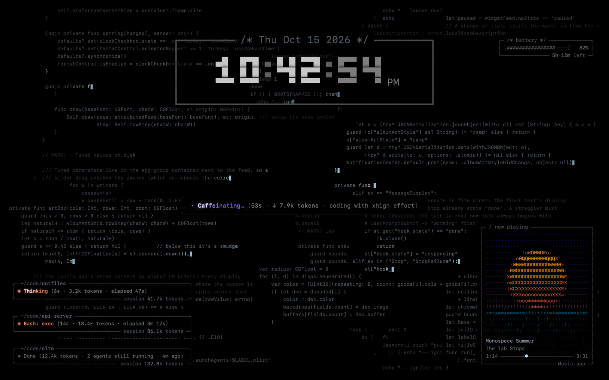

# CodeSaver — a Claude Code-inspired screensaver for the agentic coding era

Your Mac idles. The agent doesn't.



CodeSaver fills the screen with code sampled from your own GitHub repos, typed out live by a fleet of invisible coders in SF Mono, while a Claude Code-style spinner grinds away in the center:

```
✽ Sprokbooking… (2m 7s · ↓ 1.6k lines · still coding with xhigh effort)
```

## What it does

- **Background**: chunks of real code from your repos type in across the screen — glowing typing head, block cursor, whitespace skipped so the stream never stutters, settled lines dimming with age. Chunks place around loose band anchors with gaussian jitter, and new lines clip whatever they land on, terminal-style, so the layout never reads as a grid.
- **Spinner**: cycles verbs from a tab-delimited `Gerund<TAB>Past` list through a full request lifecycle — a latency window with just the glyph and glowing verb, then a streaming phase with elapsed time, an asymptotic line counter, ↓/↑ arrows with long-tailed dwell times (↑ = upload bursts: rarer, counter surges, typing speeds up), and a status that climbs Claude Code's real escalation ladder — `coding → still coding → coding more → coding some more → almost done coding with xhigh effort` at the real 10/20/30/45s thresholds. The status shows in continuous stints: each stint restarts the ladder and rolls its think time up front (long-tailed, so the last rung takes the same rare 45-second think it does in the terminal), capped to end at least a second before its decode segment — a reply never lands mid-"still coding". Eventually:

  ```
  ✻ Sprokbooked for 2m 7s
  ```

  …flat grey, resting, background typing eased down to its slowest — then a new request begins.
- **Clock**: a TUI box in the spirit of Claude Code's welcome banner — heavy box-drawing rails with the date as a centered comment (`/* Sun Jul 12 2026 */`), the time in chunky `▀▄█` half-block digits with ticking seconds, and AM/PM on the digits' baseline. Toggleable (and switchable between 12/24-hour) from the **Options** sheet in System Settings; the spinner panel re-centers under whatever the clock occupies.
- The glyph ping-pongs through `· ✢ ✳ ✶ ✻ ✽`, the verb glows left-to-right, and the whole scene's tempo eases between states — everything on pure black, so OLED and miniLED displays render it borderless.
- **Ignition** (optional): a tiny LaunchAgent keeps a fresh capture of your desktop ready, and the saver itself opens with a **two-boom, cell-quantized intro** (`BoomCore.swift`). macOS's own trigger (idle timeout or hot corner) starts the saver; its opening frame is the captured desktop — pixel-for-pixel what the system transition just left — so the handoff lands on a picture of itself. Idle triggers play a 5-second pre-animation: a bordered `✽ Verbing… (T-5s)` line beside where your mouse rests, counting down; hot corners detonate immediately. Then the grid takes over — nothing ever draws between cells. The first shockwave pixelates the desktop into one color per cell behind a ragged, dithered front of flashing cells (the wave's shape is entirely emergent from per-cell flash-and-decay; no circle is ever drawn), stamps random spots of *actual code* from your corpus over the mosaic in barely-translucent white, and flings code characters *through* the grid as inverse-video cells trailing cooling cells. A second, denser front follows and flips the pixels over — each cell shows its own color's complement for a beat, code glyphs knocked out in black, then dies to black. Flung glyphs decay from the end of their flight, settle onto cells, and fade through grey into nothing; writers ignite in the second front's wake; the clock assembles piece-wise under the burst; and the idle line teleports to its home panel — a flash where it stood, a blocky blip where it lands, a beat of nothing, and then it simply is there. All displays act as one machine: a single shared session and clock spans every screen, the fronts share one radius so they cross bezels coherently, and glyphs flung on one display settle on another. Lock/password behavior stays stock — the boom is choreography inside the real system saver.

## Requirements

- macOS 14 (Sonoma) or later — the screensaver is a modern ExtensionKit `.appex`
- Xcode 15+
- A GitHub token for fetching your repos: one click imports it from an authenticated [`gh`](https://cli.github.com) CLI, or paste a PAT with repo read access
- For the live session widgets only: [Claude Code](https://claude.com/claude-code) and a `python3` (the stock `/usr/bin/python3` is enough — the hook is stdlib-only)

## Build & install

```bash
./appex/install.sh                # build, sign, install to /Applications
open /Applications/CodeSaver.app  # the app walks you through the rest
./build.sh && ./helper/install.sh # optional: the ignition LaunchAgent
python3 feeds/wire-settings.py    # optional: live Claude Code session widgets
```

`install.sh` auto-detects your Apple Development team from the keychain (`TEAM_ID=…` overrides; a free Apple ID via Xcode → Accounts works) — no other configuration exists outside the app. Everything after the build is the app's job: the window is a three-step checklist — enable the screensaver, connect GitHub, switch on auto-refresh — plus an optional fourth, **Live widgets**, whose own switch registers the widget feed daemon described below (nothing else ever turns it on). A prebuilt `CodeSaver.app` needs no repo at all: drag it into /Applications, open it, same steps. The saver works without a corpus (it types a small built-in sample until the first refresh lands) and without any of the optional pieces — a missing igniter, an unwired Claude Code, or no music player simply leaves that act out.

With the igniter installed, use **macOS's own trigger**: set System Settings → Lock Screen → "Start Screen Saver when inactive" to taste, and/or bind a hot corner to Start Screen Saver. Or let the igniter be the trigger: the app's Ignition section binds its own corners (optionally behind ⌘/⌥/⌃/⇧) and an idle timeout of its own — leave macOS's hot corners unbound then, so the two don't race. A modifier corner follows macOS's grammar: hold the key first, then drive the cursor in; a modifier pressed with the cursor already in the corner is a ⌘Tab, not a gesture, and is ignored (igniter.log says so). The agent only scouts: after ~20 s of inactivity (tunable: `defaults write com.michelg10.CodeSaver.Igniter captureAfterIdle -float 20`) it captures each display once and records the mouse — the screen is static precisely because you're idle, so one capture suffices and costs nothing. It also watches the cursor approach saver-bound hot corners and captures pre-emptively, so corner launches detonate instantly. Captures are deleted the moment you return. Grant the igniter **Screen Recording** permission for the pixelated-desktop act — without it (or without a fresh capture, e.g. a surprise activation) the saver simply starts normally, and the app's Ignition section says so, with a button to the right pane of System Settings. Same at the lock screen: ScreenCaptureKit lists no displays there, so a corner hit on the lock screen starts the plain saver — it is not treated as a permission failure (only a real denial triggers the ten-minute capture backoff). Launch decisions and capture failures are logged to `~/Library/Logs/CodeSaver/igniter.log`; `codesaver-igniter --corners` prints corner config plus the lock/permission state the agent sees. `build/codesaver-igniter --capture` writes a one-off manifest for testing.

## The corpus feeds itself

The app owns its data — nothing is baked in at build time. It lists your non-fork repos (private ones included when the token is yours), downloads each changed repo's tarball, filters out non-source files (extension allowlist, size windows, `node_modules`-style dirs, generated-file patterns, bulk directories), and packs every cleaned file **whole** into `corpus.bin` with a repo-keyed byte index — deduplicating by content hash and dropping secret-looking lines. A `pushed_at` manifest makes re-runs incremental. Everything lives in the shared app-group container (`~/Library/Group Containers/<TeamID>.com.michelg10.CodeSaver/`), which is the only place your code exists — the app and saver bundles embed none of it. Spinner verbs follow the same rule: import your own tab-delimited `Gerund<TAB>Past` list under **Advanced** in the app and the saver prefers it over the bundled one.

At runtime the saver memory-maps the corpus from the container and draws a fresh ~400-file subset each launch — repos weighted by √(file count) with a per-repo share cap, so big projects dominate only within reason — decoding files lazily and refreshing half the subset every time a spinner "request" completes. Corpus swaps are atomic renames and the reader validates the index against the bin, so a refresh can never torn-read a running saver.

**Staying fresh**: the "Refresh automatically" toggle registers a LaunchAgent via `SMAppService` (it appears under CodeSaver in System Settings → Login Items; `install.sh` registers it too). It ticks hourly at the lowest QoS launchd offers — `ProcessType Background`, `Nice 20`, low-priority I/O — and the process gates itself: work happens at most once per ~day and **only on AC power**, except that a missing corpus is fetched immediately. Dissenters can flip the one-line predicate `RefreshService.powerGateSatisfied()`. Headless CLI, mostly for scripts: `CodeSaver --refresh [--force]`, `--import-gh-token`, `--register-agent` (the refresher; the feed daemon too, but only if it is already on), `--reregister-feeds` (cycle an enabled feed daemon after its plist changed or a `launchctl bootout`; a no-op when it is off), `--feeds` (the daemon itself, what the LaunchAgent runs), `--activate`; `CODESAVER_GITHUB_TOKEN` overrides the Keychain.

## Live widgets: Claude Code sessions and now playing

Optional, and off until wired. With them, the saver shows what the machine is actually doing while it idles: one rounded TUI box per live Claude Code session bottom-left — the project directory, `✽ Thinking (12s)`, `Bash: exec`, `Permissions required`, a resting `✻ Done (2m 7s · 4.1k tokens)` — glyphs in Claude's orange (orange is real Claude Code; violet stays the saver's own theater), active sessions floating above resting ones. Bottom-right, the track playing in Music or Spotify, with a progress bar and the cover rendered as a text-ramp mosaic. Every panel is a character grid like the rest of the saver.

Three parts, each independent:

1. **The feed daemon** — `CodeSaver --feeds`, a KeepAlive LaunchAgent (`com.michelg10.CodeSaver.feeds`) behind the app's **Live widgets** switch — the only thing that turns it on; `install.sh` merely keeps an enabled one running on the new build. Once a second it merges its sources into `widgets/feed.json` in the app-group container — the only place the sandboxed saver can read — and the saver polls that file. A feed older than 20 s (daemon gone) removes every panel: frozen state is never shown as live. No sources at all means an empty feed and no panels; nothing to configure, nothing to see.
2. **Claude Code hooks** — `python3 feeds/wire-settings.py` edits `~/.claude/settings.json` (backup kept beside it): the state writer `feeds/cc-state-hook.py` goes on ten session events (`SessionStart`, `UserPromptSubmit`, `PreToolUse`, `PostToolUse`, `PostToolUseFailure`, `PermissionRequest`, `MessageDisplay`, `Stop`, `StopFailure`, `SessionEnd`, all `async`), and the statusline is wrapped by `feeds/cc-statusline-wrapper.sh`, which passes your existing statusline through untouched and tees its JSON into the same writer every 5 s for the model name and token counts. Both scripts are copied to `~/.claude/codesaver/bin` so the repo can go away afterwards (`--dev` points at the checkout instead); state lands in `~/.claude/codesaver/sessions/`, one small JSON per session, pruned after a day. `--dry-run` shows the diff, `--uninstall` puts the old statusline back. Restart Claude Code once; panels appear on the next prompt.
3. **Now playing** — polled from Music / Spotify by AppleScript, only while the player is running. macOS asks for Automation consent the first time the app window opens (the daemon can't prompt; the app does it on the bundle's behalf, one approval covers both). Paused music stays on the panel for half an hour. While neither player has anything playing, the Office HomePods stand in, labelled `HomePod`: their state comes off home-control's encrypted bus (`~/bin/michelg10-apps/home-control`) (kv `state`, the snapshot `homectl state` reads), opened with keys derived from the home key `setup-secrets.sh` keeps in the login Keychain — `kv` and `art` only, so the daemon can read the room but never send it a command. Every 5 s while they play, every 15 s otherwise, never while this Mac plays; a Mac without those Keychain items never asks. Their cover shows only while Room has been open during the track: the bridge uploads covers only for a watcher, and the saver never claims to be one. The cover mosaic is on/off under **Advanced → album art**, with a tuning window.

The `pause` and `pin` Claude Code mods (claude-mods; the file contract is its `PAUSE.md`) are **optional** and simply not read when absent: the hooks alone carry every state above. Loaded in a session, the pause mod keeps a live state file at `~/.claude/live/<session>.json` (`$CLAUDE_LIVE_DIR`) — every model request and tool call in flight, how the last turn ended, context size, background tasks, pause state — and a session with a fresh one (its pid alive, rewritten within the last minute) takes its state from it: *thinking*, *responding* and *writing the tool call* told apart as they happen, an instant *Done* on Escape (there is no hook for an interrupt), a long think that never decays to *Done*, and pauses — `✽ Pausing… waiting for Bash (42s ∙ …)` while a paused session finishes what was under way, then a resting `✻ Paused (12m ∙ elapsed 15m)`. *Permissions required* stays the hook's: the live file doesn't see the dialog. The pin mod writes `~/.claude/live/pins/<session>.json` per pinned session, which rests on the rack as `✻ Pinned (next ping in 35m ∙ 2h 32m ago)` and outlives the one-hour idle cutoff; a pin file not rewritten for a minute reads `pin silent`, one whose session died is ignored. bifrocate's CoT spools (`~/.bifrocate/cot/`) are still read as a legacy fallback for a session without a live file, and go once the mods are loaded everywhere. `./build.sh && ./build/feeds-check` runs the daemon's merge on fabricated files in a temp directory — never on `~/.claude`.

## Repo layout

```
appex/                         the screensaver (ExtensionKit appex + host app)
├── CodeSaverExtension/        the .appex — CodeSaverView.swift is the whole show,
│                              BoomCore/BoomMetal.swift the intro + Metal renderer
├── CodeSaver/                 SwiftUI host app: install / preview UI, GitHub
│                              fetch + corpus build (GitHubCorpusFetcher.swift),
│                              refresh gates + LaunchAgent (RefreshService.swift),
│                              widget feed daemon (FeedsService.swift), album-art
│                              ramp renderer + tuning window (AlbumArt*.swift)
├── install.sh                 build + install to /Applications + pluginkit
└── BACKGROUND.md              appex screensaver architecture notes (upstream)
feeds/                         the Claude Code side of the widgets
├── wire-settings.py           installs/removes the hook + statusline wiring
├── cc-state-hook.py           hook + statusline state writer (stdlib python)
├── cc-statusline-wrapper.sh   tees the statusline JSON into the writer
└── albumart/ramp.py           reference renderer the Swift port was verified against
helper/                        ignition scout: idle/corner watcher → desktop capture
├── Igniter.swift              the codesaver-igniter agent (single file)
└── install.sh                 install/uninstall the LaunchAgent
build.sh                       builds the windowed preview / snapshot harness
Sources/PreviewMain.swift      windowed preview / PNG snapshot renderer
Sources/FeedsCheck.swift       the feed daemon's merge on fabricated files (build/feeds-check)
Sources/MarqueeTuner.swift     standalone window for tuning the music panel's marquee
```

The snapshot harness is how the aesthetics were tuned: `./build.sh && ./build/preview --snapshot <dir> <t1> <t2>…` renders deterministic frames offscreen (`CODESAVER_WORKDUR` pins the cycle length, `CODESAVER_CLOCK_EPOCH` the clock, `CODESAVER_SEED` the scene; `CODESAVER_WIDGETS=0` leaves the live session panels out).

## Tuning

Run `./build.sh && ./build/preview` for a live windowed preview with a floating **tuning panel**: sliders for the clock's geometry and brightness, the spinner panel's position, and the background code's alphas, fade rate, glow strength, and vignette — all applying live, all auto-saved to `build/clock-tuning.json` so chosen values can be promoted to the defaults in `CodeSaverView.swift`. (The preview view is drawn 33pt taller than the window, hanging off the top edge, so vertical positions match the menu-bar-less fullscreen saver; a "Reset to defaults" button restores the compiled values.)

Everything not on a slider lives as constants in `appex/CodeSaverExtension/CodeSaverView.swift`: the palette (`accent`, glow colors), typing speeds and newline cost in the writer logic, dwell/duration distributions in `startCycle`/`updateSpinner`, status escalation thresholds in `statusText(since:)`, and the glyph cadence in `workingString()`.

The boom is tunable the same way: click anywhere in the live preview to detonate at that point (the tuning panel's **Replay boom** re-fires the last origin), sliders cover both fronts' sweep times, the gap between them, and debris density, and `CODESAVER_BOOM="x,y,armSeconds"` (fractions of the view) arms it deterministically for the snapshot harness — e.g. `CODESAVER_BOOM="0.3,0.6,1" ./build/preview --snapshot /tmp/boom 1.25 1.7 2.1 4.6`. `CODESAVER_CAPTURE=/path.png` supplies the stand-in "desktop" the first front pixelates; without it the preview uses `build/stand-in-capture.png` if you've dropped a screenshot there (gitignored — it's your real screen), else it synthesizes a bright fake desktop (wallpaper, windows, dock) so the pixelation act is actually visible. Flash decay, code-spot density, darkening, and settle physics live as constants in `BoomCore.swift`.

## Credits

- Appex scaffolding derived from [AppexSaverMinimal](https://github.com/AerialScreensaver/AppexSaverMinimal) by Guillaume Louel (MIT — see `appex/LICENSE`), whose reverse-engineering of the macOS appex screensaver format made this possible. `appex/BACKGROUND.md` is his write-up.
- Aesthetic homage to [Claude Code](https://claude.com/claude-code).

## License

[MIT](LICENSE). The appex scaffolding is derived from AppexSaverMinimal (MIT, Guillaume Louel — see `appex/LICENSE`).
